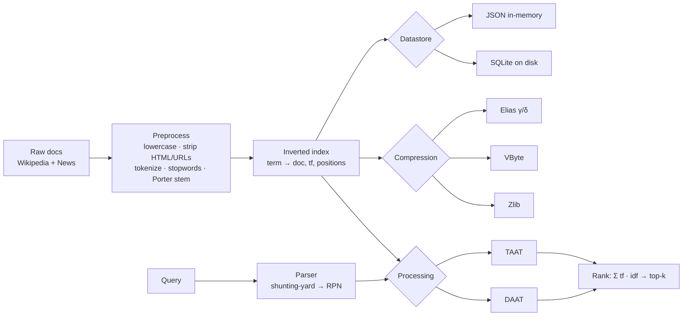

# SelfIndex: a high-performance retrieval engine, built from scratch

[](https://github.com/63shivendra/High-Performance-Retrieval-Engine-for-Retrieval-Augmented-Generation-RAG-/actions/workflows/ci.yml)


The retrieval layer of a RAG system ("R"), implemented without a search library. It includes inverted indexes with
positional postings, a Boolean query parser, TF and TF-IDF ranking, term-at-a-time and document-at-a-time query
processing, and postings compression. It was benchmarked against **Elasticsearch** on 100,000 documents.

### 🔎 [**Try the live demo →**](https://selfindex-search.onrender.com)

> Hosted on a free tier, so the first request after a period of inactivity can take ~30–60 s while the container wakes up.

[](https://selfindex-search.onrender.com)

---

## Highlights

| | |
|---|---|
| ⚡ **Faster than Elasticsearch (warm cache)** | **9.47 ms** P95 latency and **275 QPS**, vs 10.22 ms and 220 QPS for Elasticsearch on the same 100K-doc corpus and 256 queries |
| 🧱 **Built from first principles** | Positional inverted index, shunting-yard Boolean parser (AND / OR / NOT / PHRASE / parentheses), TF and TF-IDF scoring |
| 🔀 **Two query-processing strategies** | TAAT (score accumulators) vs DAAT (multi-pointer merge), measured head-to-head |
| 🗜️ **Compression** | Elias γ/δ with gap encoding (−74.8% index size), VByte, Zlib (−59.6%), plus √n skip pointers |
| 💾 **Pluggable storage** | In-memory JSON store or disk-backed SQLite |
| 🧪 **Tested and deployable** | 58 pytest tests, GitHub Actions CI with a Docker smoke test, one-click Render deploy |

## What's in the live demo

* Search ~4,000 English Wikipedia articles with **Boolean**, **TF** or **TF-IDF** retrieval, using **TAAT** or **DAAT** processing.
* See the exact query the parser executed, the stemmed terms, the scores, highlighted snippets and engine latency.
* **Compare all 6 configurations** on any query (median of 7 runs each).
* Browse the full-scale benchmark table and plots.
* REST API with interactive docs at [`/docs`](https://selfindex-search.onrender.com/docs).

```bash
curl "https://selfindex-search.onrender.com/api/search?q=quantum+physics&model=tfidf&mode=taat&k=5"
```

## Architecture



Index variants follow the naming scheme `SelfIndex_i{x}d{y}c{z}o{optim}`:

| Parameter | Options |
|---|---|
| `i` index type | `1` Boolean · `2` TF · `3` TF-IDF |
| `d` datastore | `1` JSON · `2` SQLite |
| `c` compression | `1` none · `2` Elias γ/δ · `3` Zlib |
| `o` optimization | `0` none · `sp` skip pointers |

## Results (100K documents, 256 queries, top-10)

| System | Configuration | P95 (ms) | P99 (ms) | QPS | Index size |
|---|---|---:|---:|---:|---:|
| **SelfIndex** | TF-IDF · JSON · TAAT | **9.47** | 11.93 | **275** | 651 MB |
| SelfIndex | TF-IDF · JSON · DAAT | 16.12 | 19.94 | 157 | 651 MB |
| SelfIndex | TF-IDF · SQLite · TAAT | 10.94 | 14.01 | 242 | n/a |
| SelfIndex | TF-IDF · Zlib · TAAT | 25.71 | 127.94 | 103 | 263 MB |
| SelfIndex | TF-IDF · Elias γ/δ · TAAT | 119.38 | 228.25 | 27 | 164 MB |
| SelfIndex | Boolean + skip pointers | 10.80 | 12.11 | 357 | 1,322 MB |
| Elasticsearch | warm cache | 10.22 | 11.91 | 220 | 418 MB |
| Elasticsearch | cold cache | 12.60 | 13.74 | 98 | 418 MB |

Raw numbers are in [`results/`](results/), and plots are in [`plots/`](plots/).

<p align="center">
  
  
</p>

### Key findings

* **TAAT beats DAAT by ~70% in Python.** Sequential postings scans have better cache locality and less interpreter overhead than juggling many pointers. DAAT usually wins in compiled engines, where its early-termination advantages dominate.
* **The Boolean paradox.** Boolean retrieval had the highest throughput (344 QPS) but the worst tail latency, because materializing large unranked result sets is expensive. That suits batch filtering better than user-facing search.
* **Compression is a dial.** Zlib is the balanced option. Elias coding saves the most space but costs ~12× latency from bit-level decoding in pure Python.
* **JSON vs SQLite.** The in-memory JSON store was ~15% faster. SQLite is the choice once the index no longer fits in RAM.
* **Preprocessing** (stopwords and Porter stemming) cut the vocabulary by **48.6%**, and the term distribution follows Zipf's law.

The full write-up is in [`report_detailed.pdf`](report_detailed.pdf).

## Run it locally

**Live demo (about 1 minute):**

```bash
pip install -r requirements-app.txt
python -m nltk.downloader stopwords punkt punkt_tab
uvicorn app.main:app --reload        # → http://localhost:8000
```

Or with Docker:

```bash
docker build -t selfindex . && docker run -p 7860:7860 selfindex   # → http://localhost:7860
```

**Tests:**

```bash
pip install pytest httpx && pytest -q
```

**Full research pipeline (100K docs):**

```bash
pip install -r requirements.txt
# Put the Wikipedia parquet files in data/wiki/ and the Webz.io news zips in data/News_Datasets/
python build.py -x 3 -y 1 -z 1 -optim 0                  # build an index variant
python query.py -x 3 -y 1 -z 1 -q T -optim 0 --interactive
python evaluate.py -x 3 -y 1 -z 1 -q T -optim 0          # latency / throughput / memory
python build_es.py && python evaluate_es_all_scenarios.py   # Elasticsearch baseline
```

Pre-built indices: [Google Drive](https://drive.google.com/drive/folders/15bKzPq0s4G_gNo3Ecq_n-83LIv3UJ8tK?usp=sharing)

## Deploy your own

[](https://render.com/deploy?repo=https://github.com/63shivendra/High-Performance-Retrieval-Engine-for-Retrieval-Augmented-Generation-RAG-)

The included [`Dockerfile`](Dockerfile) also runs as-is on **Hugging Face Spaces** (Docker SDK, port 7860), Railway and Fly.io.

## Project structure

```
src/                     core engine
  self_indexer.py          Boolean index + query parser (x=1)
  self_indexer_x2.py       TF ranking (x=2)
  self_indexer_x3.py       TF-IDF ranking (x=3)
  sqlite_indexer.py        SQLite datastore (y=2)
  compression/             Elias γ/δ, VByte, Zlib codecs
  skip_pointer_builder.py  √n skip pointers
  daat_query.py            document-at-a-time processing
  es_indexer.py            Elasticsearch baseline
app/                     FastAPI live demo + static front end
tests/                   pytest suite (engine + API)
build.py · query.py · evaluate.py   CLI for building, querying, benchmarking
results/ · plots/        benchmark outputs
docs/                    design notes (optimizations, ES evaluation methodology)
```

## Tech stack

Python · NLTK · FastAPI · SQLite · Elasticsearch (baseline) · pandas / matplotlib · Docker · GitHub Actions

---

**Shivendra Pratap Singh**. Originally built for a graduate Information Retrieval course (2025).
